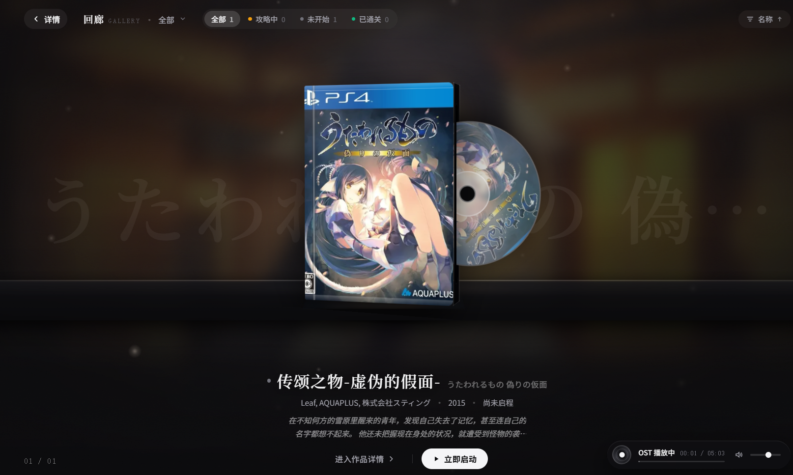
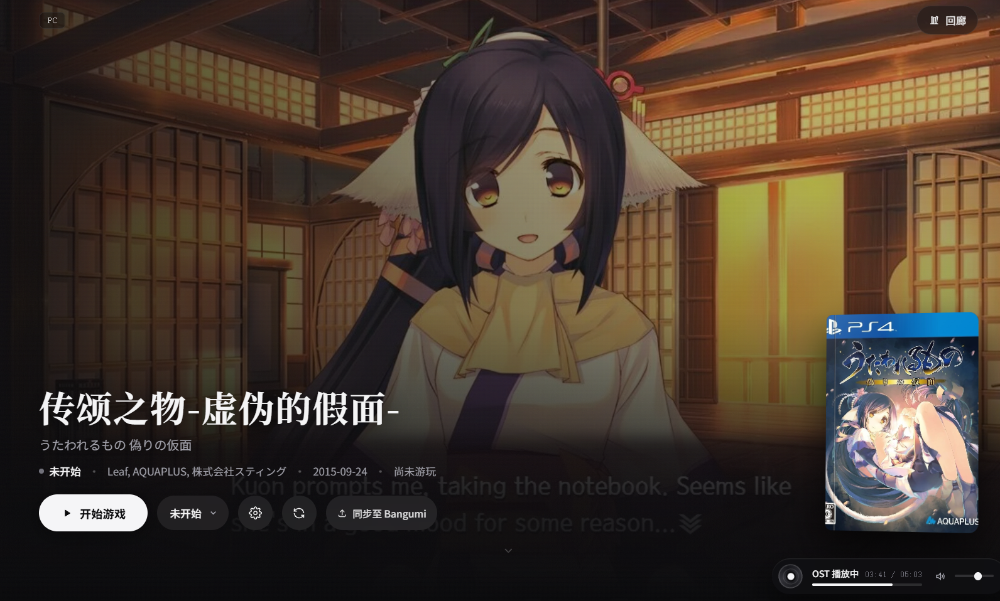

  

  <h1>Tsumugi</h1>

  
本地优先的沉浸式视觉小说与单机游戏库管理器

  

    <a href="#下载与安装">下载安装</a>
    &nbsp;·&nbsp;
    <a href="#界面预览">界面预览</a>
    &nbsp;·&nbsp;
    <a href="#核心特性">核心特性</a>
    &nbsp;·&nbsp;
    <a href="docs/DEVELOPMENT.md">开发文档</a>
  

---

## 界面预览

  

  

---

## 核心特性

- **本地优先，数据自主**：游戏档案、封面图、主题曲、宣传片与存档快照全部保存在本地 `data/` 目录，不依赖云端账号，随时可整体备份迁移。
- **沉浸式回廊与全屏体验**：支持 3D 实体侧封与展柜双视图、系列聚合排序、无边框极简顶栏与 `F11` 全屏漫游，搭配隐私模糊开关与全局留声机。
- **多源资料与 Steam 优先影音刮削**：聚合 VNDB、Bangumi、Steam、SteamGridDB 与 TouchGal 资料，支持任意单字段或单项图片在线查找替换；宣传片默认优先获取 Steam 官方预告，并支持按平台切换查找。
- **游玩计时与历程拼图**：自动记录每次游玩时长并生成年度热力图与时间账本；支持按游玩时长生成等比模块化封面拼图，一键导出高清 PNG 海报。
- **单文件安装与无损覆盖升级**：免管理员权限安装、内置更新检查，后续新版本直接覆盖安装即可完整保留本地游戏库与存档。

---

## 下载与安装

1. 前往 [Releases](https://github.com/Shimozi-zzz/Tsumugi/releases) 下载最新的 **`Tsumugi-Setup-*.exe`**。
2. 双击安装程序，按向导选择安装位置即可完成安装。
3. **无损升级**：后续版本直接运行新版安装包覆盖原目录即可，程序数据保存在安装目录下的 `data/` 文件夹，覆盖升级与卸载均不会删除你的游戏库与存档。

---

 **[开发者文档 (docs/DEVELOPMENT.md)](docs/DEVELOPMENT.md)**。
